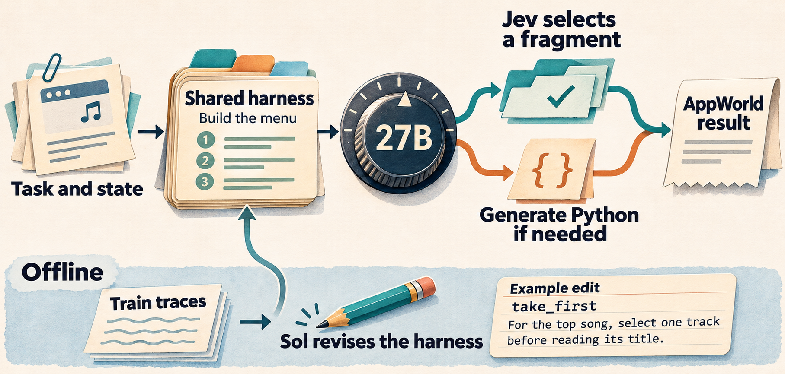

<h1 align="center">Jev Harness RSI</h1>

<p align="center"><strong>One 27B model chooses actions or writes code. Sol uses execution traces to improve the shared harness.</strong></p>

<p align="center">
  <a href="#a-spotify-task">Example</a> · <a href="#how-it-works">How it works</a> ·
  <a href="#quickstart">Quickstart</a> · <a href="#what-sol-can-change">What Sol can change</a> ·
  <a href="#evaluation">Evaluation</a> · <a href="docs/experiment.md">Protocol</a> · <a href="docs/reproduce.md">Reproduce</a>
</p>

<p align="center">
  
</p>

An AppWorld agent may write the same few lines of Python every time it reads a playlist or looks up a note. Jev Harness RSI gives it reusable operations called **fragments**. A program builds a menu from the current state. A single 27B model selects actions through its Jev decision head and can switch to Python generation for work the menu cannot express. Between runs, GPT-6.2 Sol uses execution traces to revise the shared harness. The 27B weights stay fixed.

## A Spotify task

*What is the title of the most-liked song in my Spotify playlists?* In an earlier Train run, both harness versions found the songs and sorted them correctly. The difference came when the agent had to turn that ranking into a single title.

| Harness | Actions after sorting | Jev calls | Generated tokens | AppWorld outcome |
|---|---|---:|---:|---|
| Initial harness (H0) | Extract titles → submit the list | 10 | 0 | Failed |
| First Sol revision (`b01r01`) | Take the first song → extract its title → submit | 13 | 0 | Passed |

H0 already had a `take_first` fragment. Sol edited its guidance to tell Jev to take one song from the ranking before extracting its title. In the second trace, Jev chose `take_first` before `titles`. Both traces come from Train task `82e2fac_1`, on the same GPU with the same seed. Each Jev call used one separately counted readout token. [Recorded actions, counts and exact edit](docs/spotify-example.json)

## How it works

- **Build the menu.** Each fragment declares what it needs and what it returns. Templates and live values supply the question and every option. Jev can choose a menu, select a fragment and bind its parameters. Each result can make another fragment available.
- **Decide or reason.** For the next-fragment choice, the official decision API first scores the options. If the top probability is below **0.60**, the same model can think for up to **256 tokens**. The final choice uses the average of the two probability distributions. A “none” choice in a narrow menu first opens the wider menu.
- **Hand off to generation.** When the available fragments leave work to do, Jev can select relevant guidance and the 27B continues in the same AppWorld session. Generated code can request a registered read with `yield_read`, which returns control to the menu with the new data.

## Quickstart

With Python 3.10 or newer, you can inspect the full experiment on a CPU.

```bash
git clone https://github.com/OmniAI-Lab-CUHKSZ/jev-harness-rsi.git
cd jev-harness-rsi
python -m pip install -e ".[test]"
jev-appworld plan > plan.json
```

`plan.json` contains the initial harness, model budgets and every task ID. To run the Spotify example with H0, set up the model and AppWorld workers, then run this command. [GPU setup and connection settings](docs/reproduce.md)

```bash
jev-appworld smoke --connections configs/connections.local.example.json \
  --root runs/spotify --gpu local:0 --task 82e2fac_1
```

Open `runs/spotify/smoke_result.json` for the score and token count. Its `trace_path` points to the menus, choices and actions for that attempt.

## What Sol can change

Sol reads the nine Train traces and picks a specific event that could explain a failed task or costly generation. It compares two explanations at that same event. It can retrieve earlier Train tasks that performed the same operation and inspect how their results were used. Sol then edits up to **three named objects** across six parts of the harness.

| Component | What an edit can change |
|---|---|
| Execution adapter | How an app receives login or API arguments and which part of the response the agent reads |
| Fragment | A reusable operation, its inputs and outputs, and the guidance for choosing it |
| State view | Which facts from earlier tool results Jev or the generator sees at the next step |
| Menu assembly | Which fragments appear together and which state values bring more candidates into a menu |
| Decision | The question, guidance or ordering Jev uses to choose a menu, action or parameter |
| Generation handoff | Which guidance Jev can select for the generator and which public reads can return to the fragment loop |

Sol can try a proposed edit on the focal Train case and a preservation case. The draft and revision share 24 fresh judgments, three generations and 4,096 offline 27B output tokens for those trials. The draft may spend up to 12 of the judgments. A revision can use the balance. Evidence requests list returned results, continuations and items that require correction. The program also checks the latest successful recording of each previously solved earlier Train task. At the first differing request it either queries Jev on the changed menu or reports a changed tool call or generation handoff. It stops there even when Jev selects the original action. Identical requests share a response across tasks and the revision. Sol receives the differences and a count of matching choices, with every checked task available to inspect. These historical judgments have separate cost accounting. Sol then submits the draft, revises it once, or keeps the parent. AppWorld provides the whole-task scores. [Optimizer and prompts](jev_harness/batch_revision.py) · [Historical Train checks](jev_harness/solved_train_preview.py)

## Evaluation

| Split | Scenarios / tasks | How it is used |
|---|---:|---|
| Train | 30 / 90 | Ten batches of nine tasks. Sol has two optimization rounds per visit. Each submitted candidate reruns the nine tasks. |
| Dev | 19 / 57 | Select the harness carried into the next batch. H0 is measured once and the retained parent's scores are reused. |
| Test-N | 30 / 90 | On a subset of AppWorld Test-Normal, compare the generation-only 27B agent with the same 27B using the final harness, paired by task and GPU. |

All three variants of a scenario stay in one split. Train and Dev select first by tasks solved, then by fewer online output tokens. An exact tie keeps the candidate. Starting with H0, each GPU runs one model replica serving two independent AppWorld sessions. Four GPUs provide eight task slots.

Both Test-N arms get 40 model calls and 8,192 generated tokens per task. The runner reports task success, the share of scenarios with all three tasks solved, and online output tokens. These include open generation, low-confidence reasoning and recorded retries. Decision readouts and offline Sol usage are reported separately. [Experiment design](docs/experiment.md) · [Exact configuration](jev_harness/resources/experiment.json)

[Four-GPU run and output files](docs/reproduce.md#run-the-experiment) · [AutoTrust 27B model](https://huggingface.co/autotrust/AutoTrust-Decider-Pro-27B) · [AppWorld](https://github.com/StonyBrookNLP/appworld) · [JevAgentHarness](https://github.com/JevAgentHarness/JevAgentHarness)
